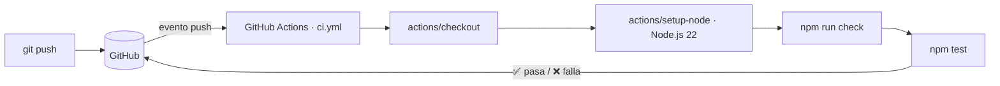

# ci-practica-equipo01 · Calculadora de Varillas con integración continua

[](https://github.com/ErickrU/ci-practica-equipo01/actions/workflows/ci.yml)

Práctica de **integración continua con GitHub Actions** del **Equipo 01 – Help Desk 360**.
En lugar de una calculadora de ejemplo, el pipeline protege una aplicación real: **Calculadora de Varillas**, una PWA sin dependencias que calcula cuántas varillas longitudinales necesita una columna de concreto armado según la NTP E.060 (Perú), concordante con ACI 318.

> **Uso académico.** La aplicación no reemplaza el análisis estructural completo ni la revisión de un ingeniero responsable.

## Equipo

| Integrante | Rol |
|---|---|
| Erick Alexander Rangel Urbina | DevOps Engineer |
| Leylani Jamileth Perea García | QA / Test Automation Engineer |
| Diana Yamileika Tellez Ordoñez | Scrum Master / Product Owner |

**Materia:** Gestión del Proceso de Desarrollo de Software · **Grupo:** IDyGS 101 · **Docente:** Netzer Gabriel Díaz Jaime

## Objetivo de la práctica

Comprobar que cada `git push` ejecuta automáticamente las pruebas del proyecto en GitHub Actions, observar una ejecución exitosa, provocar un fallo intencional y reflexionar sobre la ventaja de detectar errores antes de liberar el software.

| Fase | Qué se hizo | Dónde verlo |
|---|---|---|
| 1. Repositorio | Repositorio `ci-practica-equipo01` con README | Este repositorio |
| 2. Proyecto funcional | Aplicación + 26 pruebas unitarias del motor de cálculo | [`js/calculo.js`](js/calculo.js), [`test/calculo.test.mjs`](test/calculo.test.mjs) |
| 3. GitHub Actions | Workflow `CI` que instala Node.js y ejecuta las pruebas en cada `push` | [`.github/workflows/ci.yml`](.github/workflows/ci.yml) |
| 4. Verificación | Ejecución automática, duración y tareas realizadas | [Pestaña Actions](https://github.com/ErickrU/ci-practica-equipo01/actions) · [`docs/EVIDENCIA-CI.md`](docs/EVIDENCIA-CI.md) |
| 5. Fallo intencional | Commit `Error intencional` que invierte un signo en una fórmula y hace fallar las pruebas; luego se corrige | [`docs/EVIDENCIA-CI.md`](docs/EVIDENCIA-CI.md) |

## El pipeline



`npm run check` valida la sintaxis de los módulos y el `manifest.webmanifest`; `npm test` ejecuta las pruebas con el test runner nativo de Node (`node --test`), sin instalar paquetes. Los mismos dos comandos se usan en local, así que lo que falla en GitHub falla igual en la máquina del desarrollador.

## Qué cubren las pruebas

Las pruebas de [`test/calculo.test.mjs`](test/calculo.test.mjs) fijan los resultados que la aplicación debe dar siempre, tomados de [`docs/CALCULATIONS.md`](docs/CALCULATIONS.md) y de la norma:

- catálogo de varillas, estribo automático (E.060 7.10.5.1) y separación mínima (E.060 7.6.3);
- validación de la entrada: dimensiones, `fy > 0,85·f'c`, cuantía entre 1 % y 6 % (E.060 10.9.1);
- número de barras: redondeo, mínimo de 4 o 6 barras (E.060 10.9.2) y simetría en secciones rectangulares;
- distribución geométrica en secciones rectangulares y circulares;
- resistencia axial `φPn,máx` (E.060 10.3.6);
- el ejemplo reproducible `30 × 50 cm, ρ = 1 %, 5/8" → 8 varillas` y otros casos completos, incluidas advertencias y errores.

## Inicio rápido

Requiere Node.js 20 o posterior. La aplicación no instala paquetes.

```bash
git clone https://github.com/ErickrU/ci-practica-equipo01.git
cd ci-practica-equipo01
npm run check   # sintaxis + manifest
npm test        # 26 pruebas unitarias
npm start       # servidor local en http://localhost:8080 (solo escucha en 127.0.0.1)
```

Los service workers requieren `localhost` o HTTPS; no abras `index.html` directamente con `file://`.

## La aplicación

- columnas rectangulares, circulares con estribos y circulares con espiral;
- cálculo por cuantía longitudinal (`1 %–6 %`) o carga axial última `Pu`;
- seis diámetros de barras corrugadas y selección automática de estribo;
- mínimo normativo de barras, armado simétrico y separación libre;
- diagrama SVG de la sección a escala y tabla de alternativas;
- validación accesible asociada a cada campo, tema oscuro o claro, instalable y funcional sin conexión;
- cálculo local: no envía ni almacena los datos del formulario.

### Ejemplo

Para `30 × 50 cm`, `ρ = 1 %` y barras de `5/8"`:

```text
Ag            = 1,500.00 cm²
As requerido  = 15.00 cm²
Resultado     = 8 varillas de 5/8"
As colocado   = 16.00 cm²
ρ colocado    = 1.07 %
Distribución  = 3 barras por cada cara b y 3 por cada cara h
```

Este mismo caso es la primera prueba del pipeline.

## Estructura

```text
ci-practica-equipo01/
├── .github/
│   ├── workflows/ci.yml     Pipeline de integración continua
│   ├── ISSUE_TEMPLATE/      Plantillas de issues
│   └── pull_request_template.md
├── docs/
│   ├── EVIDENCIA-CI.md      Evidencia de las fases 1 a 5 y conclusiones individuales
│   ├── evidencia/           Logs descargados de cada run y diff del error intencional
│   ├── ARCHITECTURE.md      Componentes, decisiones y pipeline
│   └── CALCULATIONS.md      Fórmulas, unidades y limitaciones
├── test/
│   └── calculo.test.mjs     Pruebas unitarias (node:test)
├── js/
│   ├── calculo.js           Motor de cálculo sin DOM (lo que prueba el CI)
│   ├── app.js               Interfaz y diagrama SVG
│   ├── widgets.js           Panel de widgets
│   └── registro-sw.js       Instalación, actualización y conexión
├── css/estilos.css
├── iconos/                  Fuentes SVG y PNG para la PWA
├── widgets/                 Plantilla y datos del widget «Último cálculo»
├── herramientas/            Servidor local, generador de iconos y verificador de widgets
├── index.html · offline.html · manifest.webmanifest · sw.js
└── package.json             Scripts: start, check, test
```

## Documentación

- [Evidencia de la práctica y conclusiones](docs/EVIDENCIA-CI.md)
- [Cálculos, unidades, ecuaciones y limitaciones](docs/CALCULATIONS.md)
- [Arquitectura de la PWA y del pipeline](docs/ARCHITECTURE.md)
- [Guía para contribuir](CONTRIBUTING.md)
- [Política de seguridad](SECURITY.md)

## Origen

La aplicación proviene del repositorio [`ErickrU/calculadora-varillas`](https://github.com/ErickrU/calculadora-varillas). Para esta práctica se conservó la aplicación completa, se agregaron las pruebas unitarias y el workflow de CI, y se retiró la infraestructura de despliegue en AWS, que no forma parte del ejercicio.

## Licencia

[MIT](LICENSE) © 2026 Erick Alexander.
