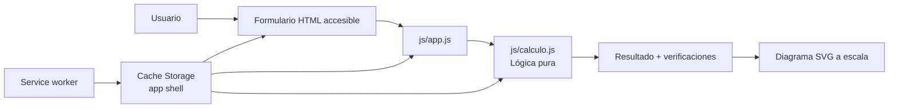
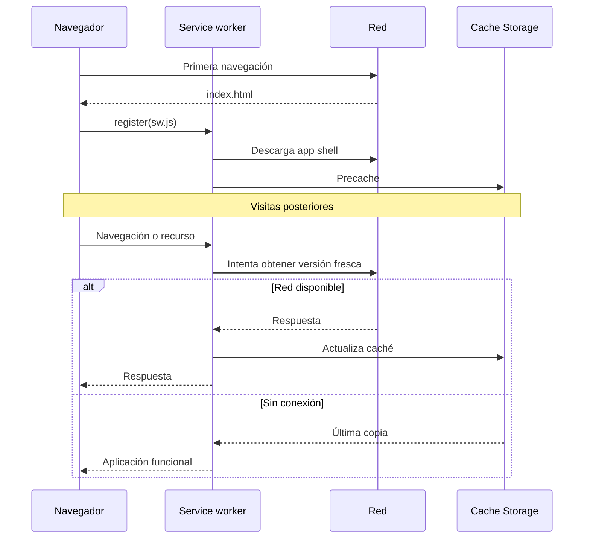
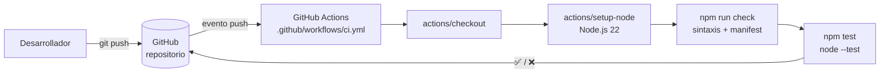

# Arquitectura

## 1. Objetivo

Calculadora de Varillas es una PWA estática para estimar el refuerzo longitudinal de columnas de concreto armado. Debe funcionar en navegadores modernos, instalarse como aplicación y conservar todas sus funciones sin conexión después de la primera visita.

No requiere backend: los datos ingresados se procesan localmente y no se almacenan ni transmiten.

## 2. Arquitectura de la aplicación

### Componentes

| Componente | Responsabilidad |
|---|---|
| `index.html` | Estructura semántica, datos solicitados y panel de resultados |
| `js/calculo.js` | Validación, fórmulas, distribución y alternativas; no usa DOM |
| `js/app.js` | Adaptador entre formulario, motor de cálculo y presentación |
| `js/registro-sw.js` | Instalación, compartir, tema, ayuda, Window Controls Overlay, conexión y actualización de la PWA |
| `sw.js` | Precache del app shell y estrategias de respuesta offline |
| `manifest.webmanifest` | Nombre, colores, iconos y comportamiento instalable con WCO y `standalone` |
| `css/estilos.css` | Temas, diseño adaptable, barra WCO, estados, foco visible y página offline |

La separación del motor (`calculo.js`) permite verificar las fórmulas sin un navegador y evita que la presentación altere el resultado numérico. La cabecera ofrece exactamente cinco controles accesibles: instalar, compartir, tema, restablecer y ayuda. El restablecimiento invoca el evento nativo del formulario para reutilizar la limpieza implementada por `app.js`.

Cuando la PWA instalada expone `navigator.windowControlsOverlay`, la cabecera usa las cuatro variables `titlebar-area-*`, zonas `drag`/`no-drag` y sincronización de `geometrychange` con 200 ms de espera. Si el rectángulo es angosto, la cabecera pasa a una fila inferior para no solapar los controles del sistema. Una pestaña normal o un navegador sin la API conserva la misma barra como cabecera web.

## 3. Flujo de cálculo

1. El formulario solicita geometría, materiales, método y varilla.
2. `app.js` normaliza los datos y llama a `calcularColumna`.
3. `calculo.js` valida rangos, calcula `Ag`, determina `As`, redondea el número de barras y comprueba la separación.
4. Si la entrada no es válida, la interfaz enlaza cada mensaje con su control y mueve el foco al primer error.
5. Si es válida, la interfaz presenta la propuesta, observaciones, alternativas y un SVG generado a la misma escala de la sección.

Las fórmulas, unidades y limitaciones están en [`CALCULATIONS.md`](CALCULATIONS.md).

## 4. Ciclo de vida PWA

`VERSION` en `sw.js` identifica el cache del shell. Al incrementarla, el nuevo worker instala recursos y la interfaz ofrece actualizar; los caches antiguos se eliminan durante `activate`.

## 5. Integración continua

Cada `push` dispara el workflow `CI`, que ejecuta en un runner `ubuntu-latest` los mismos comandos que se usan en local (`npm run check` y `npm test`). El resultado queda asociado al commit: una marca verde indica que las fórmulas siguen produciendo los valores fijados por las pruebas; una marca roja bloquea la integración hasta corregir el defecto.

Decisiones:

1. **Test runner nativo de Node (`node:test`)**: no agrega dependencias al proyecto, que es una de sus reglas de diseño.
2. **Las pruebas cubren solo `js/calculo.js`**: es el módulo sin DOM; la interfaz se verifica manualmente en el navegador según `CONTRIBUTING.md`.
3. **Sin despliegue automático**: el pipeline es de integración continua, no de entrega continua. No usa secretos ni permisos adicionales.

## 6. Seguridad y privacidad

Amenazas consideradas:

| Riesgo | Control |
|---|---|
| Código remoto comprometido | Sin dependencias ni CDN de terceros |
| Resultados de cálculo enviados fuera | Cálculo 100 % local, sin red ni telemetría |
| Servidor de desarrollo expuesto en la red | `servidor.mjs` escucha solo en `127.0.0.1` |
| Regresión silenciosa en una fórmula | Pruebas unitarias ejecutadas en cada `push` por GitHub Actions |
| Secretos en el pipeline | El workflow no usa `secrets` ni credenciales |

## 7. Restricciones

- No modela interacción P–M, esbeltez, segundo orden, cortante, confinamiento sísmico completo ni cimentación.
- No hay sincronización entre dispositivos.
- No hay observabilidad de negocio porque no hay backend.
- La integración continua verifica el motor de cálculo; la interfaz, el service worker y la instalación como PWA requieren pruebas manuales en el navegador.
